# How Varlit Works

Varlit is a format generator plus runtime. You declare a static file contract in
Rust, and Varlit writes/reads bytes according to that contract. The format itself
is not dynamic: the static `FormatSpec` in your program remains the authority.

## One Declaration, One File Format

Varlit is not a single file format. Each `varlit_format!` declaration is its
own format, with its own magic, version, block types and storage choices, and
a file is read by the reader generated from the declaration that wrote it. A
reader generated from another declaration refuses the file: a different magic
is `InvalidMagic`, and a format that pins its schema hash (`schema_hash: computed`) refuses any declaration whose wire layout
differs with `SchemaHashMismatch`. Nothing reads an arbitrary Varlit file's
values without its declaration; `inspect_layout_file` reports a native file's
physical record ranges, not its values.

## The Big Picture

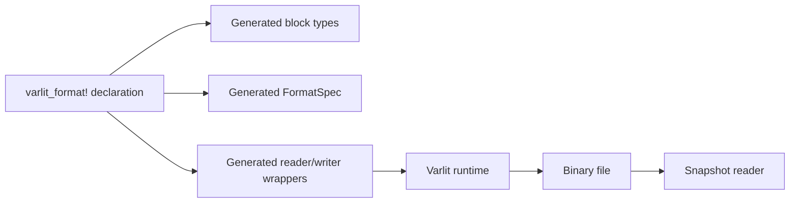

The macro handles repetitive code:

- explicit block ids and versions
- fixed/variable/matrix block structs
- typed writer methods, including `put_*` / `remove_*` for keyed storage
- typed reader methods
- native, stream and keyed handle families for the same declaration
- static registry entries
- schema hash computation when requested

The runtime handles storage mechanics:

- file headers, header extension blocks and anchors
- record headers and optional footers
- canonical encoding/decoding
- checkpoint/index scan
- compression/decompression
- integrity checks
- the published end (`VPUB`) that bounds what readers see
- stream sync-marker chains and anchor-based resume
- matrix tiles, tile directories, commit bitmaps, and the write-ahead ring
- the keyed-storage B-tree, published through the same ring
- writer locks and explicit durability calls

One declaration selects the storage paths it uses. They share the file header,
the record framing and the ring machinery:

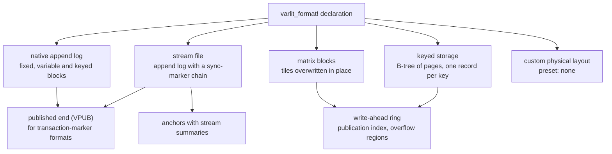

| Path | Declared with | Writes | Readers see | Read about it in |
| --- | --- | --- | --- | --- |
| Native append log | fixed / variable / keyed blocks | appends records | committed records ([commit policies](#commit-policies)) | [Append-Log Records](#append-log-records) |
| Stream file | the same blocks, opened with the stream handles | appends records in bounded batches | records up to the last verified `sync()` | [Stream Files](#stream-files) |
| Matrix blocks | `matrix` blocks | overwrites cells in tiles | one published generation | [Matrix Storage](#matrix-storage) |
| Keyed storage | `keyed_storage: in_place` | puts and removes records by key | one published generation | [Keyed Storage](#keyed-storage) |
| Custom layout | `preset: none` | the declared segments | the validated segments | [Custom Physical Layouts](#custom-physical-layouts) |

A format cannot declare both keyed storage and matrix blocks, and the stream
handles refuse a format that declares keyed storage.

## File Header

Every file starts with:

- user magic, such as `b"APP"`
- Varlit container marker: `VARVE1`, `VARVE2`, or `VARVE3`
- format version
- endian byte
- flags
- schema hash
- optional file-header extension bytes

The user magic and version prevent opening the wrong file type. The schema hash
can pin the exact declared shape when you choose `schema_hash: computed;`.

The extension bytes carry the header blocks a format uses, each framed
`magic | length`. Two matter for what follows:

- `VPUB`, the **published end**: two 24-byte checksummed slots, written
  alternately, each naming the logical end readers may see. Every
  transaction-marker format and every stream file carries it. A reader treats
  the file as ending there, so bytes a writer has appended but not yet
  published (or not yet made durable) are invisible to it. A torn slot fails its
  checksum and the other slot holds.
- the **header tail table** (`index: header_tails`): each block's newest record
  offset, the next sequence and the committed end, rewritten in place at every
  commit point, so a lazy open frames a handful of records instead of the file.

The flags byte can declare **anchors**: a fixed-size block reserved every
`spacing` bytes of the file (4 MiB by default for streams), written once when
the log first reaches it. An anchor names the record that spans it and can
carry a summary of the state before that record, so an open can start from the
newest anchor instead of from the header. The byte layout is in the
[wire contract](spec.md#file-header-flags-and-anchors).

## Custom Physical Layouts

The Varlit-native header is the default preset. A format can instead choose
`preset: none;` and declare its own byte-level layout. In that mode Varlit does
not write `VARVE1/2/3`; the declared `file_header`, segment `lead_in`,
`metadata`, `raw_region`, and optional `footer` own the physical bytes.

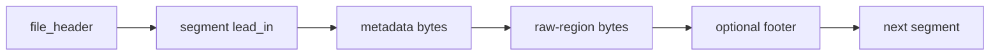

Lead-in and footer fields can be literals, caller-supplied values, or finalized
offsets such as `next_segment_offset` and `raw_data_offset`. The layout writer
writes placeholders for finalized fields, writes metadata/raw/footer bytes, then
backpatches the computed values. The layout reader validates the header,
literals, finalized offsets, forward progress, and region bounds before exposing
metadata and raw byte ranges. Declared file-header fields are also retained as
validated `LayoutFieldValue`s. Reopening a layout writer first runs that same
validation pass, then seeks to EOF so new segments are appended after the last
validated segment. Validated header/lead-in/footer values remain available on
`LayoutReader` and `LayoutSegmentInfo`, so callers can inspect fields such as
ToC masks without manual byte parsing.

When multiple segment descriptors are declared, the reader dispatches each
physical segment from the leading literal lead-in prefix. A leading byte tag is
the common case; literal numeric fields immediately after that tag can further
separate segment kinds. Once a descriptor is selected, failed footer, offset, or
bounds validation is treated as corrupt file data rather than a reason to try a
different descriptor.

When the layout is declared in `varlit_format!`, the macro generates a typed
physical-layout facade over that same engine. Segment caller fields become a
typed `FormatSegmentLayoutFields` struct, `write_segment_name` lowers them into
`LayoutFieldValue`s, and generated segment info getters read validated values
back from `LayoutSegmentInfo`. A declared file header similarly gains a typed
`file_header()` info object on the generated reader. Raw and metadata regions
intentionally remain byte slices so external adapters can own their metadata
and channel encoding. For large metadata or raw regions, generated
`write_*_streamed` methods and low-level `write_segment_streamed` let the
adapter stream bytes while Varlit still counts lengths and backpatches offsets.

`inspect_layout_file` is the strict inspection path. For custom physical files
it delegates to the layout reader; for Varlit-native files it performs the normal
strict native scan and projects each record into the same segment range model.
Use `inspect_layout_file_report` when an adapter needs a diagnostic view of the
complete prefix plus the terminal tail status before its own metadata semantics
run. That split is what lets an external adapter decide whether a failure is a
Varlit physical-layout limitation or caller-owned parsing/model logic. The
Varlit-native file header, record lead-in, and optional footer are also emitted
and parsed through an internal native layout codec that feeds the same effective
`VarlitFileHeader` and `VarlitRecord` plan, while the higher-level append-log,
recovery, compression, and index semantics stay in the native reader/writer.

## Append-Log Records

Fixed and variable blocks are stored as append-log records.

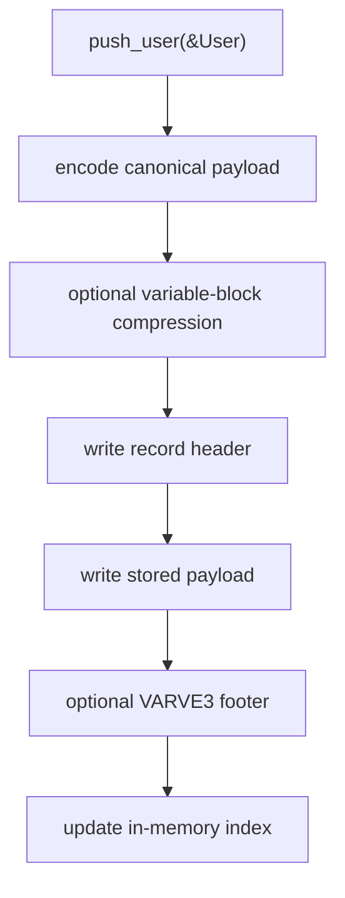

Each record header stores:

- block id
- block version
- flags
- sequence
- physical payload length
- checksum field
- uncompressed length hint for compressed records

Typed reads reverse the process:

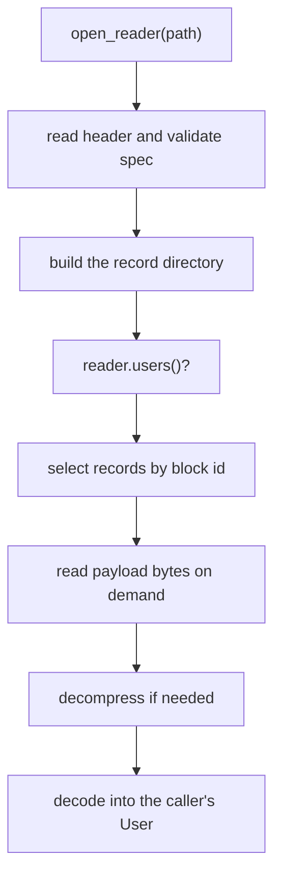

Typed reads decode into values the caller owns and reuses: `User::empty()`
once, then `users.get(&key, &mut user)`, a cursor's `next_into(&mut user)`, or
a paged `points(&mut payload, &mut out)` that fills a caller slice and returns
a cursor for the next page. Decoding grows only the caller's buffers, so a
reused value stops allocating once it has seen its largest record.

Physical APIs such as `scan()`, the generated `AppFormat::read_payload(&entry, path)`, and mmap
payload windows expose stored bytes. Typed APIs expose logical decoded values.

### How Open Builds The Directory

Step C above is the one with a policy behind it. A **record directory** is one
16-byte slot per record — the record's offset and its committed bit, the only
two facts about a record that are not in the record. Everything else an index
entry carries is rebuilt from the record's own header and footer when a read
asks.

By default open builds that directory by framing every record in the file. Three
opt-in policies change it, and they change different things:

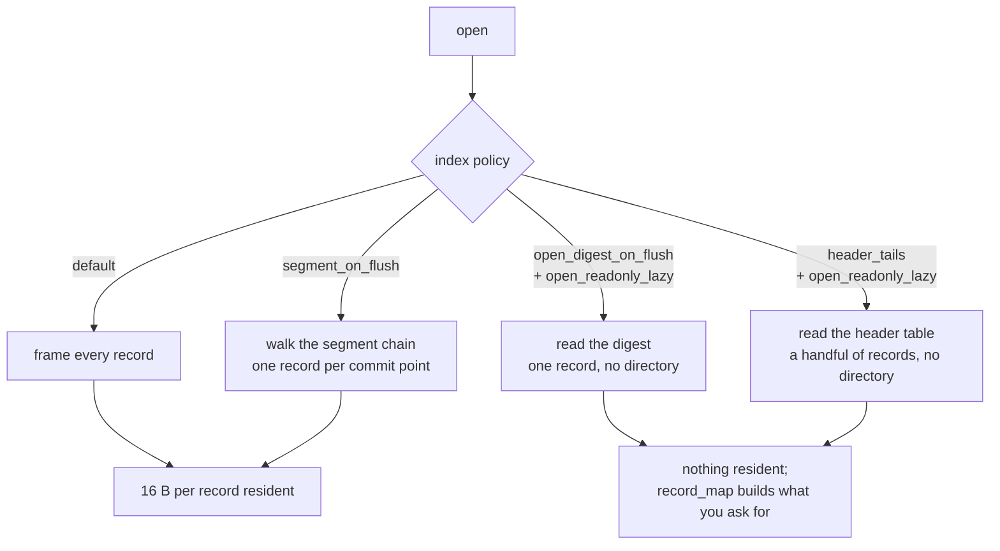

- A **segment** record carries the index entries for the records one commit
  point added, chained backwards through the record footer. Open follows the
  chain and reads no data record, so it still builds the whole directory but
  frames one record per commit point instead of one per record. It costs an
  index entry per record *on disk*.
- An **open digest** record carries the three facts an open needs that are in no
  single record: where the committed file ends, the next append's sequence, and
  each block's newest record offset. `open_readonly_lazy` reads it, frames one
  record, and builds **no directory at all** — the caller builds whatever part of
  the index its question needs with `record_map`. It costs twelve bytes per
  distinct block id on disk, whatever the record count.
- A **header tail table** (`index: header_tails`) holds the same three facts in
  a fixed region of the *file header*, rewritten in place at the end of every
  commit point. It is not a record, so nothing appended can move it or bury it —
  the one limit the digest has that is not a cost. An open that takes it frames
  the commit marker the table names, whatever closes the same commit point, and
  one record per block tail, and builds no directory either. It costs a fixed
  region in every file — 360 bytes for a two-block format — whatever the record
  count, and it is refused alongside `open_digest_on_flush`: declare one.

The segment chain and the digest are both found by probing the end of the file,
so both are appended last at a commit point; the header table sits at a fixed
offset instead. All three need the writing session to end with `flush` or
`commit`, because each corroborates itself against the end of the file. For a
file it cannot account for, an ordinary open falls back from the segment chain
to the full scan and produces the identical answer. A lazy open
(`open_readonly_lazy`, which uses the digest or the header table) is strict and
returns `LazyOpenMetadataUnavailable` instead; `open_readonly_lazy_or_scan`
scans in that case.

A **checkpoint** record (`checkpoint_on_flush`) is a third internal record and is
*not* one of these: open validates one it meets during the scan and discards the
entries. It bounds writer-side checkpoint bytes, not open cost.

## Fixed Blocks

Fixed blocks use canonical field encoding. They are fixed in the sense that the
encoded payload shape is expected to stay stable, not because Varlit copies Rust
memory layout.

Use fixed blocks for:

- small records
- stable positional fields
- snapshot-preserving, copy-on-write same-size replacement

Changing a fixed block field layout should bump the block version.

## Variable Blocks

Variable blocks encode each field as:

```text
field_id + wire_type + length + payload
```

This lets readers skip unknown fields when the wire type is known. Fields can
also use `= default`, allowing old files that lack the field to decode into a
new struct.

Use variable blocks for:

- records expected to evolve
- optional/default fields
- larger payloads that may benefit from compression

## Keyed Blocks

A block declared with `key = [id]` or `key = [a, b]` gets keyed collection
helpers.

```rust
let users = reader.users()?;
let mut user = User::empty();
let found = users.get(&7, &mut user)?;
```

For repeated keys, keyed lookup returns the newest record by sequence. For
stateful updates, use `push_op`, tombstones, merge, and compact APIs.

That model appends every update, so the file grows with the number of updates
and lookup needs a resident index. A format that declares
`keyed_storage: in_place` instead keeps one record per key in a B-tree inside
the file; see [Keyed Storage](#keyed-storage).

## Commit Policies

Varlit supports these append-log commit modes:

| Policy | Meaning |
| --- | --- |
| `commit: none` | records are visible after their complete header/payload is readable |
| `record_footer` | each visible record must have a valid footer |
| `transaction_marker(on_flush)` | `flush()` appends a marker; readers see marker-covered records |
| `transaction_marker(explicit)` | only `commit()` or `commit_durable()` appends a marker |
| `transaction_marker(<mode>, single_barrier)` | as above, but `commit_durable()` uses one storage barrier instead of two; open verifies the newest transaction before trusting it ([single-barrier commit](durability-model.md#single-barrier-commit)) |

Offset chains use `VARVE3` footers to link previous records with the same block
id and, for keyed generated writers, previous records with the same key.

A transaction-marker format publishes its end in the `VPUB` header block after
the marker is written: at once for `commit()` and `flush()`, and only after the
barrier returns for `commit_durable()`. A reader that follows therefore never
adopts a durable transaction before its sync has completed.

## Flush, Sync, And Durability

`push_*` writes through the current file handle but does not imply per-record
`fsync`.

- `flush()` pushes buffered Varlit records and writes configured checkpoint,
  manifest, or transaction marker records.
- `sync()` asks the operating system to durably persist the file.
- `commit()` writes a logical explicit marker but does not imply fsync.
- `commit_durable()` flushes/syncs covered data before writing and syncing the
  explicit marker.
- matrix durable helpers provide stronger ordered sync semantics only when you
  call them explicitly.

This is deliberate: applications choose their own durability/performance trade.
`DeviceFlush` sets how far each of those syncs goes on Apple platforms (drive
cache or OS); see the [durability model](durability-model.md#drive-cache-flush-deviceflush).

## Stream Files

The stream handles (`create_stream_writer`, `open_stream_writer`,
`open_stream_reader`) write the same declared blocks to an append log whose
open and append cost does not depend on the file's size or record count. A
stream file has no companion file: the file itself says how far it is durable.

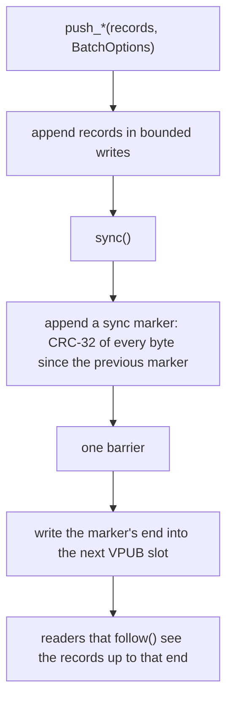

- **Sync markers chain the file.** Each marker covers every byte from where
  the previous marker ended, headers included. Readers and recovery accept a
  prefix only up to the last marker whose bytes verify.
- **The published end is the durable boundary.** `sync()` appends its marker,
  issues one barrier, then writes the end into the slot after the newest one
  (one 24-byte positional write, made durable by the next barrier). `flush()`
  writes bytes but publishes nothing, so readers do not see it.
- **Readers open at the published end.** They read it before measuring the
  file, then walk only the syncs after it whose markers verify; on a clean file
  they frame nothing. `follow()` frames only the newly confirmed records and is
  all-or-nothing.
- **Writers resume from an anchor.** `open_stream_writer` takes the newest of
  at most four anchors before the published end whose stream summary is intact
  (next sequence, record count, block tails), frames from there, keeps every
  later sync whose marker verifies, cuts the unsynced suffix, syncs and
  publishes the kept end. Open costs at most one anchor spacing of framing.
- **Older files still open.** A file without a `VPUB` block, or with both slots
  unreadable, is framed from its header and verified from its first marker's
  link start; a file with no marker keeps every record that frames.

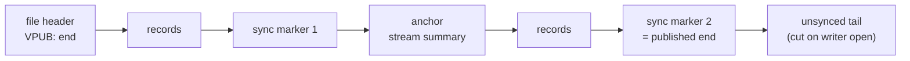

Stream readers have no lookup by key; they scan (`events()`, typed plural
methods, `follow_blocks`) and report lag with `snapshot_status()`. The byte
layout is in [stream records](spec.md#stream-records).

## Matrix Storage

A matrix lives in internal records of the append log, the first records after
the file header: a metadata record, a fixed-size write-ahead ring, directory
pages and tiles. The byte layout is in the
[matrix wire contract](spec.md#tiled-matrix-wire-contract).

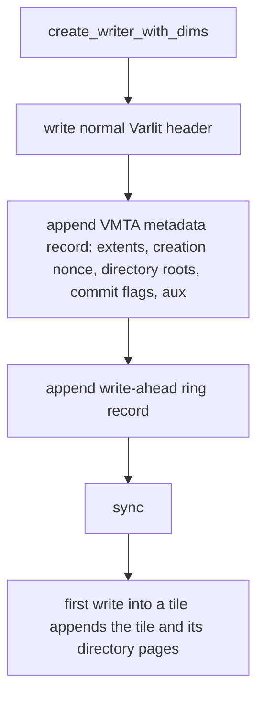

Each matrix block stores its cells in tiles of `[rows, cols]` cells: the
declared shape, or by default the largest power of two of cells whose slots
fit 64 KiB. A cell maps to a tile and a slot:

```text
tile = (scan / rows, ch / cols)
slot = (scan % rows) * cols + ch % cols
slot_offset = tile_offset + slots_start + slot * (slot_stride + 4)
```

A block finds its tiles through a radix directory keyed by the Morton code of
the tile coordinates. A tile that was never written does not exist, so a
growing dimension (`with_growing_matrix_dimension`) can be written far past its
create-time extent and the file holds only the tiles written
(`a_growing_matrix_writes_far_past_its_extent`).

Writing a matrix cell:

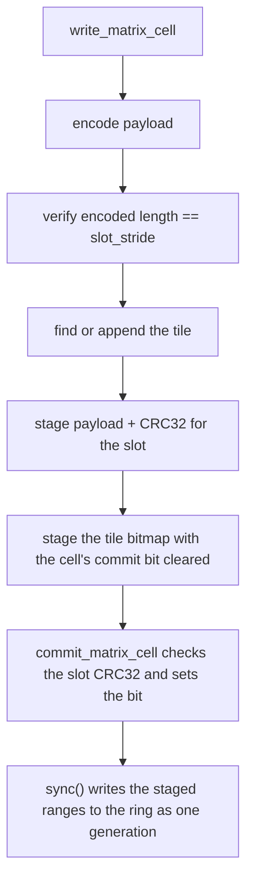

Cells are overwritten in place, but not directly: a publication writes its
byte ranges to the ring and syncs, and a checkpoint copies them into place only
when the ring needs room. A reader keeps an overlay of the ranges published
after the last checkpoint it saw, so it reads one generation until it calls
`follow()`. A reader that falls further behind than the ring holds gets
`MatrixSnapshotExpired` instead of a mix of generations. Overwrites do not grow
the file (`overwrites_keep_the_file_size_and_new_tiles_add_one_tile`).

Readers trust commit bits. If the commit bit is clear, Varlit returns
`MatrixNotCommitted` even if slot bytes exist.

A publication's staged bytes and its index live in **overflow space**: records
appended once and reused, each holding one generation's bytes and a B+tree of
4 KiB index pages keyed by target offset. The ring frames name them, so a
publication larger than the ring still commits atomically, and readers look up
ranges through a cache of 256 index pages allocated when they open. See
[publications larger than the ring](durability-model.md#publications-larger-than-the-ring).

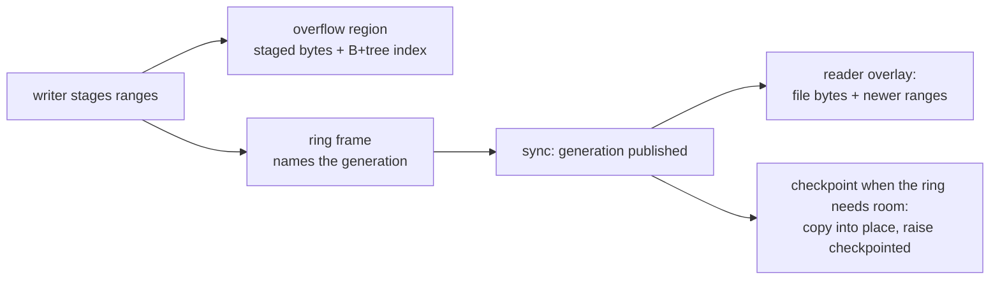

## Keyed Storage

A format that declares `keyed_storage: in_place` keeps its keyed blocks once
per key, in a B-tree of 4 KiB pages inside the file, instead of appending a
record per update. The file follows the live data, not the number of updates.

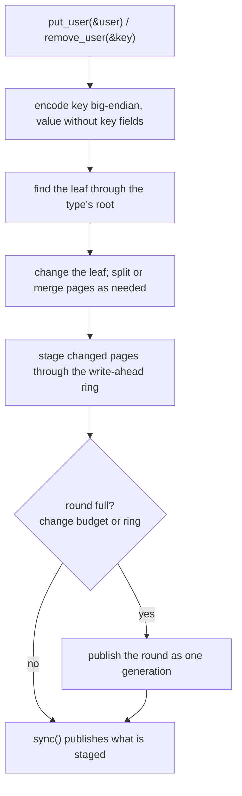

- **Pages.** Leaf (`VKLF`) and interior (`VKIN`) pages hold sorted cells;
  records over 1 KiB continue in overflow pages (`VKOV`). Pages are carved from
  blocks appended as needed (16 pages first, doubling to 1 MiB). Each keyed
  block type has its own tree, found through a slot in the metadata record.
- **Publication.** Changed pages are staged whole through the same ring,
  publication index and overflow regions as matrix storage. `sync()`
  publishes them as one generation; a load larger than the change budget
  (64 MiB by default) or the ring publishes in round-sized atomic steps.
- **Reading.** `get_user(&key, &mut scratch, &mut out)` reads only the pages on
  the path; `range_user(..)` walks leaves in key order. A reader keeps up to
  512 pages of its generation in memory. The writer raises the ring's mark
  at the end of every round so it can reuse freed pages; a reader whose
  snapshot is older gets `MatrixSnapshotExpired` and calls `follow()`.
- **Space.** Freed pages are reused once no reader can still see them. The file
  is never shrunk; rebuild it to reclaim space.

The byte layout is in the
[keyed storage wire contract](spec.md#keyed-storage-wire-contract).

## Aux Regions

`aux { thumbnail: 1024 }` reserves a byte region in the matrix metadata record.
Aux bytes are not commit-controlled and do not append records. Writes to them
are published through the write-ahead ring like cell writes. They are useful
for caller-owned caches, previews, or side data that should live in the file but
not participate in cell validity.

## Compression

Compression happens after canonical variable-block encoding and before record
write. Fixed blocks, matrix slots, and internal records are not compressed by
the append-log compression policy.

Modes:

- `record_explicit`: each compressed record carries a `VCMP` envelope.
- `file_explicit`: one file-header extension describes compression.
- `format_contract`: the static schema is the compression contract.

`ChunkedBytes` is a value-level helper for caller-managed blobs. It is not
part of matrix storage. Matrix tiles are rewritten in place and cannot be
compressed; a format declaring chunk compression is refused with
`InvalidFormatSpec`.

## Integrity And Recovery

With `integrity: crc32`, Varlit validates record payload CRCs. In `VARVE3`, the
CRC covers payload plus footer. With `integrity: crc32_with_header`, the native
record header is included too, with the checksum field normalized to zero.
Matrix storage records are rewritten in place, so their record checksum
covers the record header and footer only. Their payloads carry their own
CRC32s: each slot stores the CRC32 of its payload, each tile's commit bitmap
and each tile header carry a CRC32, as do the matrix metadata record's fixed
fields, each ring header and each ring frame. Slot CRC32s are checked on read
when the read-validation policy's `data_crc` is on; bitmap CRC32s are checked
on every read.

CRC is corruption detection, not authentication. It does not protect against a
malicious writer that can recompute checksums.

Recovery is explicit. Strict open rejects corrupt tails. Recovery open may
truncate incomplete tails according to policy. Matrix recovery APIs expose
findings and safe actions; the application chooses which action to apply.

## Self-Check Flow

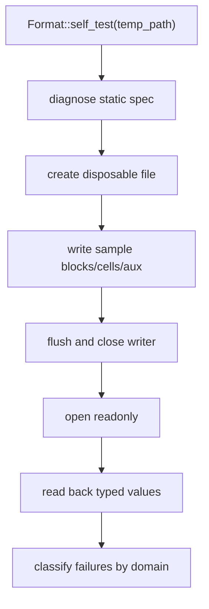

Self-check answers a practical question: do this format declaration, these
sample values, the enabled Cargo features, and Varlit's generated APIs agree?

If self-check passes but application logic fails, inspect caller-owned policy:
runtime dimensions, key construction, commit timing, sidecar meaning, migration
functions, and custom codecs.
